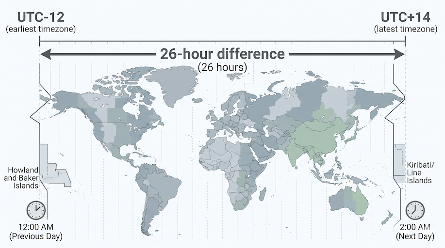
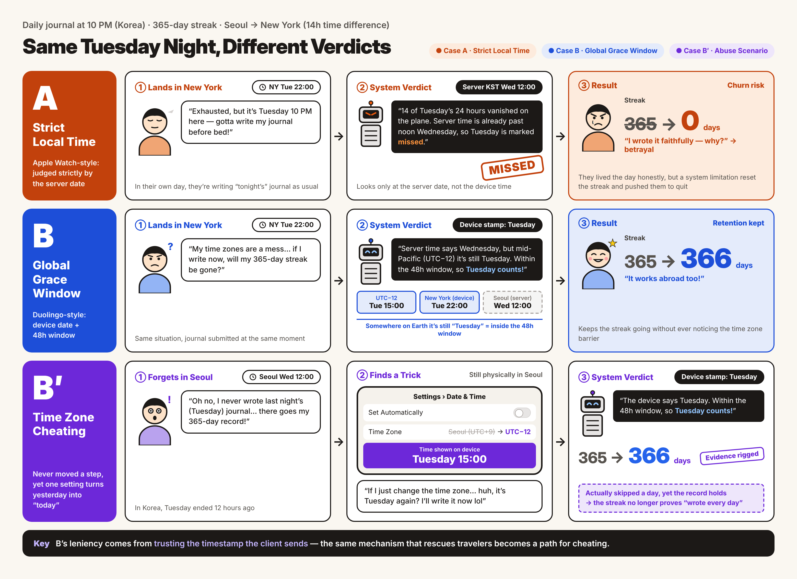

# [Weekly 5-Min Tech Talk] Handling Time in Global Services: Time Zones & Hybrid Architecture

<table>
  <tbody><tr><td><b>Presenter</b></td><td>Sujee Cho</td></tr></tbody>
  <tbody><tr><td><b>Date</b></td><td>2026-11-12</td></tr></tbody>
  <tbody><tr><td><b>Keywords</b></td><td>Time Zone, UTC, Floating Time, Edge Rendering, Grace Period, DST</td></tr></tbody>
</table>

---

## 1. TL;DR
A guide to designing a two-track hybrid architecture that separates rendering criteria based on domain characteristics—rather than blindly converting all data to UTC—to resolve time discrepancies caused by time zones and Daylight Saving Time (DST) in global services.

## 2. Problem & Background
Critical UX degradation occurs when a system mixes **Absolute Time (UTC)** and **Calendar Date (`YYYY-MM-DD`)** internally.

- **Broken data continuity:** If data written by a user at 10 PM on the 25th in New York local time is converted to UTC and stored, viewing it on a device in Korea (KST) shifts it by +14 hours and renders it as written on the "26th." As a result, the user's "daily writing" streak is marked as missed in the system.
- **Ambiguous evaluation criteria:** A deadline set by an administrator in KST gets forcibly parsed into an overseas user's browser local time, causing assignments to close earlier than intended or fail to open on time.
- **Limits of delegating to users (Google Calendar style):** In asynchronous services—unlike synchronous scheduling tools such as global video conferencing—leaving manual time zone configuration to users causes severe cognitive overload and human error.

## 3. Solution & Architecture
Instead of enforcing a single time zone policy across every feature, split the frontend time zone parsing and rendering pipeline into two tracks tailored to each feature's domain characteristics.

### 1. Floating Time Architecture
- **Target domains:** Features where daily continuity matters, such as daily journals, attendance check-ins, and habit trackers.
- **Resolution logic:**
    - Completely exclude time zone offsets and UTC conversion calculations; store the user's browser local date string (`YYYY-MM-DD`) at the moment of creation directly in the DB as the Single Source of Truth (SSoT).
    - Render the raw date text as-is without time zone parsing even on a viewer's device on the other side of the world, preserving the user's physical sense of *"I lived that day and recorded it."*

### 2. Edge Rendering Conversion Layer
- **Target domains:** Features with strict evaluation and administrative criteria, such as assignment deadlines and parent announcements.
- **Resolution logic:**
    - Strictly standardize the DB and API contract layers on the ISO 8601 UTC format including the `Z` time zone designator (`2026-11-12T15:00:00Z`).
    - At the **Edge** (the moment the frontend receives UTC from the server and renders it on screen), branch into two strategies:
        1. **Relative time rendering:** When displaying deadlines, calculate against the viewing device's time zone and render intuitively as *"Due in 14 hours"* instead of showing an absolute date.
        2. **Forced reference time zone anchoring:** For announcement release times and similar events, ignore the viewer's device time, forcibly parse using the host's time zone provided by the server (e.g., KST), and explicitly display the label alongside the time (e.g., *"Opens at 9:00 AM KST"*).

## 4. Practical Takeaways
- **Global Grace Window:** Introduce a backend handling strategy—like Duolingo's—that groups an approximately 48-hour window from the earliest time zone on Earth to the latest into "a single physical calendar date" as a supplementary metric for continuity.
    - **How the 48-hour window works:**
        - The time difference between the earliest time zone on Earth (UTC+14, Kiribati) and the latest (UTC-12, Baker Island) is 26 hours. In other words, from the moment a specific date (e.g., November 12) begins anywhere on Earth until it completely ends everywhere, roughly 48–50 physical hours elapse.
        - Duolingo's servers don't cut users off by saying, *"It's past midnight server time, so your streak failed!"* If a request arrives stamped with the "12th" from the user's device—even if it is already the 13th or early morning on the 14th in server time—the server grants a generous grace window: *"It's still the 12th somewhere on Earth, so we'll count it."*
        - Trust the `'2026-12-25'` date text sent by the frontend first, and during validation, accept it as a valid entry as long as it falls within the 48-hour window during which the 25th exists anywhere on Earth.
        - Unless you are building a financial or payment system that requires split-second precision, most services where user experience and emotion (continuity, sense of achievement) matter adopt this generous window.
    - **Two simpler alternatives commonly chosen by global services** (sacrificing some UX for easier implementation):

        1. **Global Single Reset:**
            - Ignores all users' local times and resets everyone's day simultaneously at a fixed server time (e.g., UTC midnight).
            - **Use cases:** Daily quest resets in global online games like *World of Warcraft* or *Genshin Impact*, LeetCode's Daily Coding Challenge, and *The New York Times* Wordle.
            - **Characteristics:** Free of time zone bugs and easy to implement. However, from the user's perspective, it feels unnatural—*"Why did it roll over to tomorrow's assignment when it's only 11 PM here?"* or *"The day just reset at 3 PM."*
        2. **Strict Local Time:**
            - Strictly trusts the user's device time zone and only recognizes `00:00–23:59` on that device as a single day.
            - **Use cases:** Apple Watch Fitness Activity Rings.
            - **Characteristics:** Most intuitive in everyday life, but the system breaks down the moment a user travels abroad. Flying from Korea to the US stretches a day to 38 hours—or conversely evaporates an entire day—unfairly breaking multi-year Apple Watch streaks. This has been a notorious global complaint and a textbook example of failing to provide a grace period.
                - In **watchOS 11** (released in late 2024, 10 years after launch), Apple finally introduced a defense mechanism: **"Pause Rings,"** an intuitive UX giving users a legitimate pass to rest.
                - When users struggle to close their rings due to travel (time zone changes), illness, or injury, tapping "Pause Rings" on their Apple Watch or iPhone lets them pause for up to 90 days without breaking their streak—solving the time zone problem via a UX workaround.
                - As shown here, time zone issues can be absorbed on the server side like Duolingo, or solved at the frontend/UX layer like Apple.

    
    
    - **Trade-offs of introducing a Grace Period:**
        - The pinnacle of UX design is **Invisible UX**—making everything flow naturally even when users act normally without ever thinking about system limitations or rules.
        - The decisive difference between Duolingo's and Apple's approaches to time zones is **who bears the responsibility**:
            - **Duolingo (Responsibility = System):** Users don't need to care that they crossed time zones; they just keep their own rhythm of doing lessons yesterday and today. The backend system quietly absorbs complex time-shift edge cases using a 48-hour window.
            - **Apple Watch (Responsibility = User):** While "Pause Rings" is great for illness or vacations, from a purely time zone perspective it shifts the system's limitation onto the user: *"Our system cuts off strictly by device time, so if you don't want your streak broken, remember to press Pause before boarding your flight."* If a busy traveler forgets to press Pause, their streak disappears.
        - **Why did Apple choose this "imperfect" workaround after 10 years?** Because health data on Apple Watch and language-learning data on Duolingo have fundamentally different domain characteristics, preventing Apple from granting a grace period like Duolingo:

        1. **Vulnerability to "time-travel" abuse:**
            - Among Duolingo users, a well-known trick when missing a lesson past midnight is opening smartphone settings, changing the device time zone to Hawaii (UTC-10) or Midway Atoll (UTC-11) to travel back to "yesterday," completing the lesson, and saving the streak.
            - This happens because the system leaves a generous 48-hour window open. While harmless in an app focused on personal motivation, it undermines system trust in services requiring strict rules.
        2. **Compromised data integrity (medical & statistical consistency):**
            - The decisive reason Apple could not adopt a grace period: Apple Watch Activity Rings aren't just a game—they are quasi-medical health data tied to heart rate, calories burned, and sleep patterns.
            - Loosening the definition of a day to 48 hours completely destroys statistical consistency for questions like *"How many calories did this user burn on a specific 24-hour date?"* Health data must follow absolute time or a strict 24-hour cycle to retain medical and statistical value.
        3. **Customer support (CS) and debugging nightmares:**
            - Cutting off strictly by server time (UTC) keeps logs crystal clear. With a 48-hour grace period, however, investigating a user inquiry like *"I definitely wrote my journal consecutively—why did my streak break?"* becomes extremely difficult.
            - Engineers must manually back-calculate from backend logs which time zone the user was in, when they opened the app, and whether that moment fell near the start or end of the 48-hour window, driving up maintenance costs.
        - Duolingo's 48-hour window looks ideal from a UX standpoint, but carries structural trade-offs: tolerating "time-travel tricks" and sacrificing strict data integrity. Ask yourself: *Does our service prioritize statistical precision, or the user's motivation and sense of achievement?*

    - **Other real-world examples of Grace Periods & Leeway:**
        
        Beyond Duolingo, top-tier meditation apps like **Calm** and global healthcare/habit-building apps where streak motivation directly drives revenue use this 48-hour grace window (or generous server-side time zone compensation logic)—deliberately giving up developer convenience to protect user emotion and motivation. Ultimately, **what UX our service wants to deliver** dictates our time zone architecture more than the purely technical question of how to store timestamps.
        - **Snapchat's "Snapstreak":**
            - Maintains a fire emoji (🔥) when friends exchange snaps daily. To prevent users from losing hard-earned streaks due to time zone travel or minor server clock drift, Snapchat doesn't cut off immediately at 24 hours; instead, it displays an hourglass icon (⏳) and grants several hours of implicit grace period.
        - **Habit-tracking apps like Habitica:**
            - Embrace not only time zones but also the user's **circadian rhythm**. Instead of rolling the day over strictly at midnight (`00:00`), they offer a custom **Day Start** window (e.g., *"My day starts at 4:00 AM"*), granting a grace period that counts a journal entry written at 2:00 AM as yesterday's entry.
        - **Server-to-server communication (JWT Authentication — Clock Skew Leeway):**
            - Applied at the second/minute level as well as the date level. When Server A and Server B communicate, their physical clocks may drift by 1–2 minutes. Rather than immediately rejecting a token past its expiration timestamp, backend security best practices configure a **Leeway** of roughly 30 seconds to 5 minutes to accept valid requests.

- **Delegate date arithmetic to libraries:** Adding or subtracting hours directly on JavaScript `Date` objects fails on Daylight Saving Time (DST) edge cases. Always extract the user's IANA time zone (`Intl.DateTimeFormat().resolvedOptions().timeZone`) and delegate 100% of date calculations to libraries like `dayjs` or `date-fns-tz`.

## 5. Glossary & FAQ

### Glossary
- **Floating Time**
    - A date/time representation (`YYYY-MM-DD`) not tied to any specific time zone offset or UTC instant, used when a calendar date should remain identical regardless of where it is viewed.
- **Grace Period / Tolerance Window / Leeway**
    - An intentional buffer of time granted by a system beyond a strict cutoff (such as a 48-hour global date window for daily streaks or a few minutes of clock skew tolerance in JWT verification) to absorb time zone shifts and clock drift without penalizing users.
- **Daylight Saving Time (DST / Summer Time)**
    - The practice of advancing clocks by one hour during warmer months with longer daylight to save energy, and setting them back by one hour in autumn—causing specific local days to be 23 or 25 hours long.

### FAQ
- **Q1. Should we still store timestamps in UTC even if all of our users are in Korea (KST)?**
    - **A:** Yes. Even if a service hasn't expanded globally, cloud infrastructure (GCP, AWS) and Docker container system runtimes default to UTC in most cases. Storing local time in the database leads to critical data consistency errors during server migrations or configuration changes.
- **Q2. If we use Floating Time (storing `YYYY-MM-DD`), how do we prevent users from abusing "time travel" by manually setting their device clock to the past?**
    - **A:** Add backend validation that compares the `YYYY-MM-DD` string sent by the client against the server's UTC timestamp at the moment the API request arrives, rejecting requests with physically impossible time differences (e.g., more than 48 hours apart).

## 6. References
- [W3C Internationalization Working Group — Working with Time Zones](https://www.w3.org/TR/timezone/)
- [Duolingo Engineering Blog — Time Zones and Streak Architecture](https://blog.duolingo.com/engineering/)
- [Apple Newsroom — watchOS 11 brings powerful health and fitness insights](https://www.apple.com/kr/newsroom/2024/06/watchos-11-brings-powerful-health-and-fitness-insights/)
- [Day.js Official Documentation — Timezone](https://day.js.org/docs/en/timezone/timezone)
