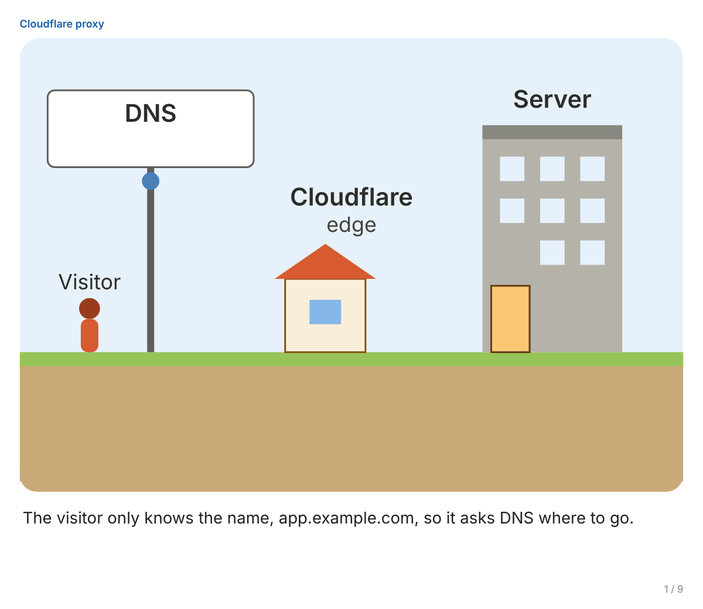
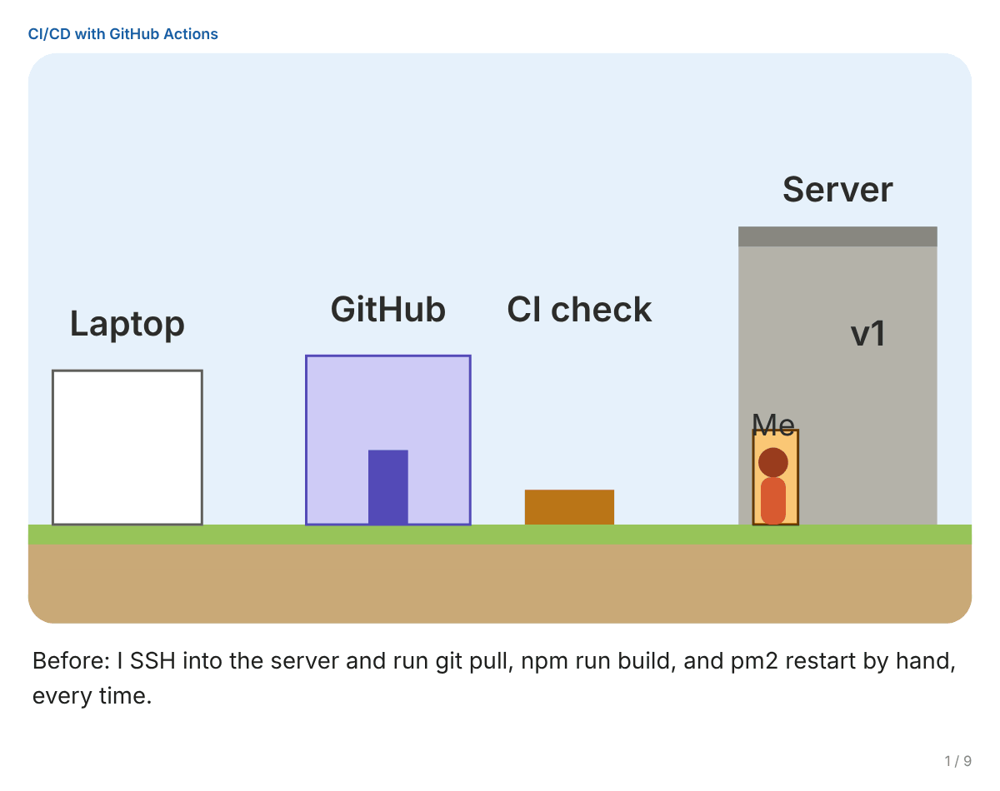

# [Weekly 5-Min Tech Talk] Web Deployment Series, Part 2: Safer Requests, Automated Deploys

<table>
  <tbody><tr><td><b>Presenter</b></td><td>Olivia Lee</td></tr></tbody>
  <tbody><tr><td><b>Date</b></td><td>2026-11-12</td></tr></tbody>
  <tbody><tr><td><b>Keywords</b></td><td>Cloudflare Proxy, Cloudflare Tunnel, CI/CD, GitHub Actions, Self-hosted Runner</td></tr></tbody>
  <tbody><tr><td><b>Series</b></td><td>Web Deployment, Step by Step — Part 2 of 2</td></tr></tbody>
</table>

---

## TL;DR
Part 1 split deployment into two paths. This part goes one step deeper on each: on the **request path**, how Cloudflare's proxy and Tunnel differ; on the **code path**, how to replace manual redeploys with GitHub Actions.
Both share one idea: **instead of letting the outside in, the server connects out first.**

## Why This Topic
- How does a request reach a server behind Cloudflare? What actually differs between the proxy and Tunnel?
- Can the three commands I typed by hand in Part 1 (`git pull → build → pm2 restart`) run on every push instead?
- If a server has all its inbound ports closed (behind a Tunnel), how does an automated deploy get in?

## Core Concepts
- **Cloudflare proxy:** With the proxy (orange cloud) on, DNS returns Cloudflare's IP instead of the server's, and Cloudflare forwards requests to the server's open port (usually 443). **Connection direction: Cloudflare → server**
- **Cloudflare Tunnel:** `cloudflared` on the server opens a connection **out** to Cloudflare and keeps it alive; requests come down that connection. **Connection direction: server → Cloudflare**
- **CI (Continuous Integration):** On every push, install and build (and test) the code to catch breakage. It never touches the server.
- **CD (Continuous Deployment):** Ship code that passed CI to the server. This needs server access (an SSH key).

## Deep Dive

### Request path: Proxy vs. Tunnel



| | Proxy | Tunnel |
| :--- | :--- | :--- |
| Who opens the connection | Cloudflare → server (inbound) | Server → Cloudflare (outbound) |
| DNS record | `A` → server IP, proxy on | `CNAME` → `<TUNNEL_ID>.cfargotunnel.com` |
| Ports the server must open | 80/443 | None |
| Direct access that skips Cloudflare | Possible (must be blocked with a firewall) | Blocked (if the server's inbound ports are closed) |
| Certificate on the server | Depends on the encryption mode | Not needed (Cloudflare handles it) |

- At the end of the tunnel, everything works like Part 1. `cloudflared` hands requests to nginx (`localhost:80`), and `server_name` routing and `proxy_pass` work as before.
- **Tunnel doesn't close ports for you.** You still close 80/443 with the firewall for the table above to hold.
- **Tunnel is not an access control.** A public hostname is reachable by anyone, so internal tools like admin pages need separate authentication (e.g., Cloudflare Access).
- With the proxy, you pick the encryption mode for the Cloudflare ↔ server leg (Flexible / Full / Full (strict)). **Full (strict)** is the recommended one.

### Code path: CI/CD



```text
push → [CI] runner: npm ci + build → stops here on failure
                    ↓ passed
       [CD] runner SSHes into the server → git pull → build → pm2 restart
```

## In Practice

```yaml
# .github/workflows/deploy-admin.yml (example, values masked)
on:
  push:
    branches: [<DEPLOY_BRANCH>]

jobs:
  ci:
    runs-on: ubuntu-latest
    steps:
      - uses: actions/checkout@v7
      - uses: actions/setup-node@v7
        with: { node-version: <SAME_AS_SERVER>, cache: npm }
      - run: npm ci
      - run: npm run build

  deploy:
    needs: ci                     # starts only if CI passes
    runs-on: ubuntu-latest
    steps:
      - uses: appleboy/ssh-action@v1
        with:
          host: ${{ secrets.DEPLOY_HOST }}
          username: ${{ secrets.DEPLOY_USER }}
          key: ${{ secrets.DEPLOY_KEY }}
          script: |
            set -e                # stop at the first failing command
            source ~/.nvm/nvm.sh  # non-interactive SSH doesn't load nvm
            cd <PROJECT_PATH>
            git pull
            npm ci
            npm run build
            pm2 restart <APP_NAME>
```

> Check each action's README for its latest major version before using this.

## Key Takeaways
- **Start with CI.** It doesn't touch the server, so it's risk-free. CD hands a server key to a machine, so decide on it separately.
- **Keys:** Create a deploy-only key instead of using your personal key, and store it in GitHub Secrets.
- **Shared servers:** Make the script touch only your project folder and your own pm2 process.
- **Rollback:** Re-running an old workflow run still pulls the latest code. To roll back, `git revert` and push.
- **`npm: command not found`:** The Node path that loads when you log in yourself isn't loaded in a scripted SSH session → `source ~/.nvm/nvm.sh`.
- **Deploying to a server with closed ports (e.g., behind a Tunnel):**

| Approach | Connection direction | Ports to open | Good for |
| :--- | :--- | :--- | :--- |
| Push over SSH | GitHub runner → server | SSH | Servers with SSH reachable |
| Self-hosted runner | Server → GitHub | None | Internal servers behind a Tunnel (private repos only) |
| SSH through the Tunnel | Runner → Cloudflare → server | None | When you can't run a runner on the server |

→ **If the door is open, push in from outside. If the door is closed, reach out from inside.** A self-hosted runner works the same way as `cloudflared`.

## Discussion
- Is our internal test server behind the proxy or a Tunnel? (Check with `dig`, `systemctl status cloudflared`, and the DNS records in Cloudflare.)
- Building on the server competes for CPU and memory with other services on the same machine. Would it be better to build on the runner and ship only the output?
- Next hands-on idea: add CI (checks only) to a repo first.

## Glossary
- **`cloudflared`:** The server-side program that opens a Cloudflare Tunnel.
- **Inbound / Outbound:** A connection coming into the server from outside / a connection going out from the server.
- **GitHub Actions runner:** The machine that runs a workflow. Either GitHub-hosted or self-hosted on your own server.
- **GitHub Secrets:** Where workflows keep secret values (keys, hosts, etc.). They're masked in logs.

## References
- [Cloudflare Tunnel](https://developers.cloudflare.com/tunnel/)
- [Cloudflare — SSL/TLS encryption modes](https://developers.cloudflare.com/ssl/origin-configuration/ssl-modes/)
- [GitHub Actions — Workflow syntax](https://docs.github.com/actions/writing-workflows/workflow-syntax-for-github-actions)
- [GitHub — About self-hosted runners](https://docs.github.com/actions/hosting-your-own-runners/managing-self-hosted-runners/about-self-hosted-runners)
- [appleboy/ssh-action](https://github.com/appleboy/ssh-action)

---
⬅️ Previous: [Part 1 — How My Code Reaches an https:// URL](./20261104_web_deployment_part1_from_code_to_url.md)
