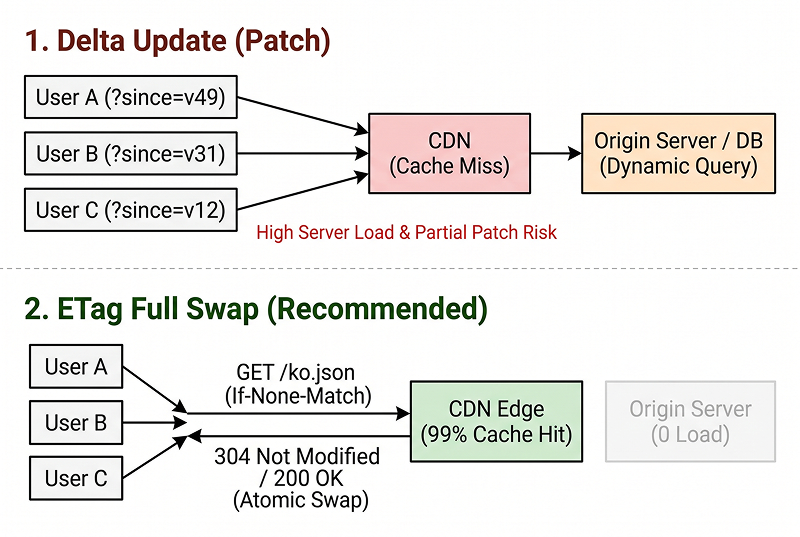
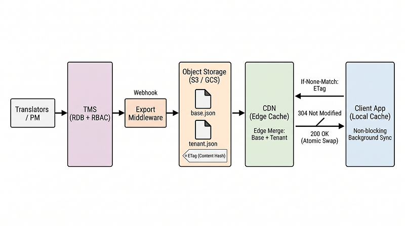

# [Weekly 5-Min Tech Talk] Multilingual OTA & White-labeling Architecture in Global Services

<table>
  <tbody><tr><td><b>Presenter</b></td><td>Sujee Cho</td></tr></tbody>
  <tbody><tr><td><b>Date</b></td><td>2026-11-20</td></tr></tbody>
  <tbody><tr><td><b>Keywords</b></td><td>i18n, OTA, ETag, Delta Update, CDN, Multi-tenancy, White-labeling, TMS, RBAC</td></tr></tbody>
</table>

---

## 1. TL;DR
An architectural guide to resolving the bottlenecks that emerge as a service scales its **Over-the-Air (OTA) localization pipeline**—delivering real-time multilingual updates without app store reviews or redeployments. It covers replacing sequential version numbers with **content-hash-based ETag CDN background syncing**, **hierarchical decoupled deployment** for white-labeling, and transitioning beyond spreadsheets to a **Translation Management System (TMS)**.

## 2. Problem & Background
As global services grow, multilingual operations typically run into four structural bottlenecks in sequence:

- **Tight coupling with app releases & developer bottlenecks:** Bundling translation JSON files inside the app binary means fixing a single typo requires a full rebuild and an app store review (1–3 days). Even when translators or PMs update copy, changes still wait on a developer to merge a PR and trigger a deployment—making this inefficiency the primary driver for adopting OTA.
- **Limits of simple version-number change detection & cache invalidation:** Even when an early OTA pipeline is built with "Spreadsheets + Scripts + a Sequential Version (or Timestamp) API," adding multiple environments (Dev/Staging/Prod) quickly causes version numbers to drift out of sync across environments. Ambiguous cache invalidation timing either leaves stale text on user devices long after an edit or triggers redundant full re-downloads when nothing changed. Fetching the latest dictionary synchronously on app launch also blocks and delays initial screen rendering.
- **Limits of spreadsheet-based collaboration & access control:** As supported languages grow and external translators join, spreadsheet limitations surface. You cannot restrict column-level read visibility within a single file to isolate a translator's view, nor can you reliably track which target keys need re-translation after a source edit or catch human errors like broken `{{variable}}` placeholders before publishing.
- **Structural collapse when scaling white-labeling on multi-tenancy:** Layering tenant-specific branding and domain terminology (white-labeling) on top of a multi-tenant architecture serving multiple B2B clients from a single codebase multiplies the `Tenant × Language` matrix exponentially. Spreadsheet formulas break, newly added keys get missed, and naive variable interpolation fails to handle grammatical friction such as Korean postpositions or gendered articles in European languages.

## 3. Solution & Architecture

### 1. Retiring Sequential Versions & ETag-Based CDN Background Sync
It is tempting to assume that a **Delta Update** (sending only the 1–2 changed keys) is optimal, but for text-based localization files, it often turns into unnecessary over-engineering.



| Approach | Pros | Cons / Trade-offs |
| :--- | :--- | :--- |
| **Delta Update (Patch)** | Minimizes network payload <br />(a few bytes) | - Users connect at different times, causing query parameters (`?since=...`) to diverge per user => **breaks CDN and cache layers (Cache Miss)** and pushes dynamic query load onto the origin server/DB<br>- If the app terminates mid-patch or misses deleted keys (Ghost Keys), the client falsely assumes it is up to date, leaving local data permanently out of sync (integrity corruption) |
| **Full Compressed Static JSON + ETag (Recommended)** | - Consolidates requests to a single URL (`/ko.json`), maximizing CDN edge caching with zero origin load<br>- Replaces the entire file at once (Atomic Swap), eliminating partial corruption<br>- Eliminates environment version drift | Re-downloads the full JSON file on change <br />(however, Gzip/Brotli compresses thousands of keys down to tens of KB) |

- **Content-Hash-Based ETag (A File's "Digital Fingerprint"):** `ETag` is a standard HTTP response header used to identify a resource's version, and populating it with a content hash (MD5, SHA-256, etc.) is the most effective strategy in practice. Even for a file tens of thousands of lines long, a hash function produces a fixed-length short string (fingerprint). Changing a single character or comma alters the hash completely (the avalanche effect), whereas identical content yields the exact same ETag regardless of how many times or which environment it is deployed to. Because object storage (S3/GCS) computes and attaches it once upon upload, there is zero runtime computation overhead.
- **S3/GCS + CDN Static Delivery & Non-Blocking Sync:** Serve translation JSON files statically via Object Storage + CDN rather than through an origin API server. On app launch, render immediately using the locally cached dictionary, and send a background check to the CDN with the `If-None-Match` header. Download and stage the updated file for the next launch only when it has changed (`200 OK`); otherwise, the CDN edge terminates the request immediately with an empty `304 Not Modified` response.

### 2. Hierarchical Inheritance & Decoupled Deployment for White-labeling
When layering custom tenant copy on top of a multi-tenant architecture, starting pragmatically with **2-tier inheritance (`Base` => `Tenant Override`)** is recommended. If a single core product later expands across multiple verticals or product lines (e.g., schools, enterprises, healthcare) and identical terminology overrides begin repeating across tenants, you can consider extending it to **3-tier inheritance (`Base` => `Domain/Vertical` => `Tenant Override`)**.

- **Preventing override key explosion (Interpolation + Exception Overrides):**
  - Extract brand names and roles into variables (`{{brandName}}`, `{{role}}`) instead of hardcoding them into sentences.
  - Resolve 80–90% of grammatical friction—such as Korean postpositions (`을/를`) or European articles—using **① custom i18n formatters** (e.g., `es-hangul`) and **② grammar-neutral noun-phrase UX writing** (e.g., `"Add {{role}}"`), reserving full tenant-level sentence overrides for the unavoidable 10%.
- **Decoupled deployment over pre-merging:**
  - Pre-merging all tiers at publish time forces a full redeployment of every tenant's bundle whenever a single `Base` string changes.
  - Instead, publish `base.json` and `tenant.json` (plus `domain.json` if introducing a vertical tier) as independent static files, then merge them either at **client runtime** (parallel fetch via `Promise.all`) or at the **CDN Edge** (e.g., Cloudflare Workers) based on the request domain (`Tenant ID`).

### 3. Moving Beyond Spreadsheets to a TMS
Once multilingual operations and white-labeling scale, the industry standard is migrating to a **TMS** (such as self-hosted open-source tools like Tolgee or Weblate, or SaaS platforms).

```text
[Translators / PMs] ──▶ [TMS (RDB + Language-Scoped RBAC Web UI)]
                                    │
                        (Change Event / Webhook Trigger)
                                    ▼
[Client Apps] ◀── [CDN (ETag Caching / Edge Merge)] ◀── [Object Storage (S3/GCS)]
```

- **Row-level RDB storage:** Editing a single key executes a single-row `UPDATE` in the database.
- **Language-scoped RBAC & automated status tracking:** Without splitting files, database queries restrict translators strictly to their assigned target language and reference source. Editing the source text automatically flags the corresponding keys in all other languages as `Needs Review`.
- **Automated syntax validation:** Blocks missing `{{variable}}` placeholders or broken newline escapes (`\n`) at save time before they reach production.



## 4. Practical Takeaways
- **Stage-based architecture adoption:**
  1. **Early stage (no white-labeling):** A single master spreadsheet with automated distribution scripts delivers strong ROI at zero infrastructure cost.
  2. **Growth stage (multi-environment deployments):** Deprecate sequential version APIs and migrate to **Object Storage + CDN + ETag background syncing** first to eliminate version drift and origin server load.
  3. **Scale stage (white-labeling & external translator collaboration):** This is the inflection point to adopt a **TMS**.
- **Hybrid strategy over forking open-source TMS:** Forking an open-source TMS codebase to inject custom white-labeling logic creates merge-conflict nightmares during upstream upgrades and security patches. The pragmatic approach is **running an unmodified open-source TMS while building a lightweight custom middleware** that listens to webhooks, performs hierarchical merging, and publishes to your CDN.
- **Separation of concerns:** Localization pipelines scale most cleanly when **authoring, access control, and history** live in an RDB (TMS), while **client delivery** is completely decoupled into static assets served via Object Storage + CDN + ETag.

## 5. Glossary & FAQ

### Glossary
- **OTA (Over-the-Air) Localization**
  - A mechanism for remotely updating multilingual text resources in client applications in real time via a server or CDN without requiring an app store review or a new binary release.
- **ETag (Entity Tag)**
  - A standard HTTP response header assigned by a server to identify a specific version of a resource. In practice, it is populated with a fixed-length digital fingerprint (content hash) derived from the file's contents, allowing clients to validate cache freshness lightly via `If-None-Match` (`304 Not Modified`).
- **CDN (Edge Server) vs. Origin Server**
  - The **Origin Server** is the primary headquarters server housing business logic and source data (e.g., a Django/Nginx server in the Seoul region). A **CDN** (CloudFront, Cloud CDN, Cloudflare, etc.) is a globally distributed network of edge servers that cache copies of static files in major cities worldwide to respond immediately from the location closest to each user.
- **Delta Update**
  - A synchronization strategy where the server computes and transmits only the changed diff/patch between a client's existing version and the latest version rather than sending the full resource.
- **Multi-tenancy**
  - A system architecture concept in which a single software instance (server, codebase, database) is shared by multiple client organizations (tenants) while keeping their data isolated.
- **White-labeling**
  - A business and branding model where a product's original branding is stripped away and replaced with a client's logo, domain, and custom terminology so it appears as the client's own service. In practice, it is typically built on top of a multi-tenant architecture, translating into per-tenant (`Tenant ID`) copy overrides in localization systems.
- **TMS (Translation Management System)**
  - A centralized platform providing translation key management, language-scoped role-based access control (RBAC), source-change tracking, placeholder validation, and automated delivery (Webhooks/CDN).

### FAQ
- **Q1. Isn't re-downloading the entire JSON file wasteful when only a single key changes?**
  - **A:** JSON text achieves 80–90%+ compression ratios with Gzip or Brotli. Even thousands of translation keys compress down to tens of kilobytes—lighter than a single low-resolution icon. Implementing backend delta updates and sacrificing CDN edge caching and file-level atomicity (Atomic Swap) just to save a few kilobytes is rarely a favorable trade-off.
- **Q2. Doesn't variable interpolation (`{{role}}`) break grammar like Korean postpositions or foreign articles in white-labeling?**
  - **A:** Yes. Rather than forcing interpolation into every string, use a hybrid approach: eliminate 80–90% of duplicate overrides first through grammar-neutral noun-phrase copy (e.g., `"Add {{role}}"`) and custom postposition formatters, and apply full tenant-level sentence overrides only for the remaining 10% where grammar requires it.
- **Q3. What about building a custom mini-TMS in-house instead of adopting an open-source TMS?**
  - **A:** Building a minimal RDB (`Key / Scope / Tenant / Lang`), simple admin UI, and CDN publisher lets you tailor your exact white-labeling inheritance model 100%. However, feature creep—such as spreadsheet import/export, diff history, and review threads—quickly turns an internal utility into a second product to maintain, so MVP scope must be strictly capped.

## 6. References
- [MDN Web Docs — HTTP ETag](https://developer.mozilla.org/en-US/docs/Web/HTTP/Headers/ETag)
- [i18next Official Documentation — Namespaces](https://www.i18next.com/principles/namespaces)
- [Tolgee Official Documentation — Content Delivery & Platform](https://tolgee.io/platform)
- [Weblate Official Documentation](https://docs.weblate.org/)
- [Cloudflare Workers Documentation](https://developers.cloudflare.com/workers/)