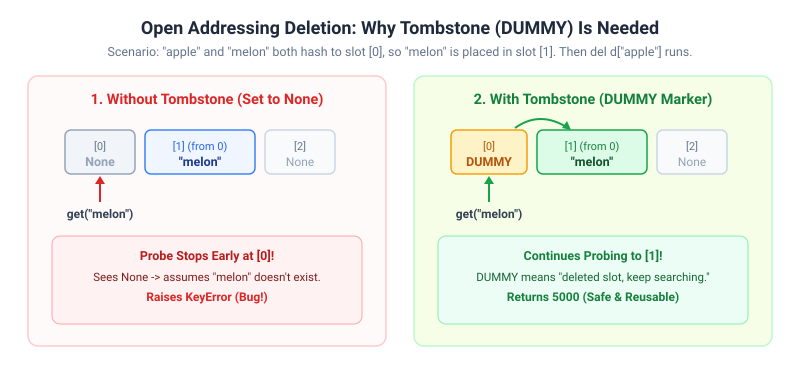
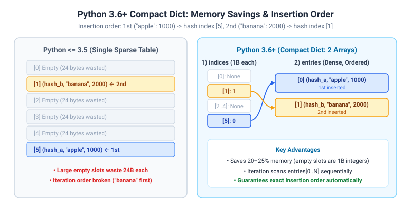

# [Weekly 5-min Tech Talk] Dissecting Python `dict` & The Two Faces of Hash

<table>
  <tr>
    <th>Presenter</th>
    <td>Sujee Cho</td>
  </tr>
  <tr>
    <th>Date</th>
    <td>2026-11-25</td>
  </tr>
  <tr>
    <th>Keywords</th>
    <td><code>Hash Table</code>, <code>Python dict</code>, <code>Open Addressing</code>, <code>Compact Dict</code>, <code>Tombstone</code>, <code>Hash DoS</code>, <code>SHA-256</code></td>
  </tr>
</table>


---

## 1. TL;DR (Core Summary)

* Python's `dict` and `set` are built on **Hash Tables**, enabling average $O(1)$ lookup, insertion, and deletion even as datasets scale to millions of records.
* Python `dict` resolves key collisions by probing for other empty slots in the array (**Open Addressing**), leaves a `<Deleted>` marker (**Dummy / Tombstone**) upon deletion so subsequent colliding items are not lost, and splits storage into an index array and a dense data array (**Compact Dict**, Python 3.6+) to save memory while preserving insertion order.
* Although data-structure hashing (`hash()`) and cryptographic hashing (`SHA-256`, covered in last week's ETag session) share the same core concept, their goals are polar opposites. Python randomizes `hash()` per process to defend against **Hash DoS attacks**, meaning it must never be used for persistent cache keys or file identifiers.

---

## 2. Problem & Background

When engineers rely on built-in data structures and hash functions without understanding their internals, subtle performance bottlenecks and production bugs emerge:

1. **Hidden Performance Bottlenecks from Linear Scans ($O(N)$):**
   * Filtering 10,000 blacklisted users against 50,000 activity logs using a `list` (`if user in blacklist_list:`) triggers up to $50,000 \times 10,000 = 500\text{M}$ comparisons in the worst case, freezing the process for several seconds.
   * Converting the lookup target to a hash-table-backed `set` reduces complexity to $O(N + M)$, finishing in a few milliseconds.
2. **Confusing `hash()` with Cryptographic Hashes (`SHA-256`):**
   * Following last week's multilingual OTA session on ETag content hashing, developers sometimes reach for Python's built-in `hash()` when they need a compact string identifier for Redis cache keys or database indexes.
   * Because Python randomizes its hash seed on every process startup, **restarting the server causes 100% cache key mismatches (Cache Misses)**.
3. **Unclear Runtime Behavior & Errors:**
   * Understanding the underlying mechanics clarifies why `TypeError: unhashable type: 'list'` occurs and why `dict` guarantees insertion order starting from Python 3.6.

---

## 3. Solution Architecture

### 3.1 Why Hash Tables Achieve $O(1)$ Lookup

A standard array jumps directly to any memory address in a single step ($O(1)$) if you know its integer index. A hash table converts keys (such as strings or tuples) into integers via a **hash function (`hash()`)**, then takes the modulo by the array size to derive the slot index directly:

$$\text{index} = \text{hash}(\text{key}) \bmod N$$

*(In CPython, the table size $N$ is always a power of two ($2^k$), allowing fast bitwise masking `hash & (N - 1)` instead of division.)*

### 3.2 Hash Collisions & Python's Resolution Strategy

Because the set of possible keys is infinite while array slots are finite, **hash collisions**—where two distinct keys map to the same index—are inevitable.

| Dimension | Separate Chaining | Open Addressing |
| :--- | :--- | :--- |
| **Mechanism** | Appends colliding items to a linked list hanging off the bucket | Probes forward within the same array until an **empty slot** is found |
| **Strengths** | Graceful degradation under high load; straightforward deletion | Zero pointer overhead; contiguous memory yields **high CPU cache locality** |
| **Weaknesses** | Extra memory overhead from node objects and pointers | Lookup latency spikes sharply as the array nears full capacity |
| **Used By** | Java `HashMap`, C++ `unordered_map` | **Python `dict` / `set`** |

To prevent clustering and $O(N)$ degradation in Open Addressing, Python `dict` enforces three safeguards:

* **Uniform Bit Mixing:** Uses SipHash rather than naive attributes (like string length) to scatter keys evenly across the table.
* **2/3 Load Factor Resizing (66.7%):** Once two-thirds of the slots are occupied, Python doubles (or quadruples for small tables) the array size and re-inserts existing entries (**Rehashing**), ensuring at least one-third of slots remain empty.
* **Perturb Probing:** Instead of checking the immediate neighbor (`+1`) on collision, Python mixes upper hash bits to jump across distant slots.

### 3.3 Deletion Bugs & The Tombstone (`DUMMY`) Mechanism



Suppose `"apple"` hashes to slot `0`, and `"melon"` also hashes to `0`, forcing `"melon"` into slot `1`.

* If deleting `"apple"` resets slot `0` to `None` (empty), a subsequent lookup for `"melon"` checks slot `0`, sees `None`, assumes `"melon"` was never inserted, and terminates early with a `KeyError`—even though `"melon"` is sitting right next door at slot `1`.
* **Solution:** Instead of `None`, Python writes a special **`DUMMY` (Tombstone)** sentinel into deleted slots:
  * **On Lookup:** Encountering `DUMMY` signals *"keep probing"* so the search continues to slot `1`.
  * **On Insertion:** `DUMMY` slots are treated as vacant and overwritten with new entries.

### 3.4 Python 3.6+ Innovation: Compact Dict (Memory Savings + Insertion Order)



In Python 3.5 and earlier, `dict` used a single sparse array storing 24-byte `(hash, key*, value*)` structs directly. Because at least one-third of slots had to stay empty, large chunks of memory were wasted, and keys were scattered by hash order rather than insertion order.

Introduced in Python 3.6, **Compact Dict** splits storage into two separate arrays:

```text
1) indices (Sparse array: stores lightweight 1~8 byte integer indexes)
[0]: None
[1]: 1      --+  ("banana" lives at entries[1])
[2]: None     |
[3]: 0      --+--+ ("apple" lives at entries[0])
              |  |
2) entries (Dense array: packed tightly in exact insertion order)
              |  +-> [0]: (hash_a, "apple",  1000)   <- 1st inserted
              +----> [1]: (hash_b, "banana", 2000)   <- 2nd inserted
```

* **20–25% Memory Reduction:** Empty slots in `indices` only waste a single byte (or a few bytes for huge dicts) instead of 24 bytes.
* **Automatic Insertion Order & Faster Iteration:** Running `for k, v in d.items():` scans the dense `entries` array sequentially from index `0`, skipping sparse empty slots entirely.

### 3.5 Two Faces of Hash: `hash()` vs. `SHA-256` (ETag)

Both compress arbitrary data into fixed-size values, but their design goals are fundamentally opposed.

| Dimension | Non-Cryptographic Hash (Python `hash()`) | Cryptographic Hash (`SHA-256`, ETag) |
| :--- | :--- | :--- |
| **Primary Goal** | **Maximum speed** (in-memory indexing) | **Integrity & security** (tamper detection, preimage resistance) |
| **Collision Tolerance** | Tolerated (resolved via probing) | Computationally infeasible ($2^{256} \approx 1.15 \times 10^{77}$) |
| **Determinism** | **Changes every process run** (`PYTHONHASHSEED`) | **100% identical across time and machines** |
| **Ideal Use Cases** | In-memory `dict`, `set`, local lookups | HTTP ETags, persistent cache keys, passwords, Git commits |

**Why does Python `hash()` change on every run? (Hash DoS Mitigation)**
In 2011, attackers exploited deterministic hash functions by sending HTTP payloads containing tens of thousands of crafted keys that all collided onto the same bucket index, degrading server lookups from $O(N)$ to $O(N^2)$ and pinning CPU at 100% (**Hash DoS**). Since Python 3.3, a random `PYTHONHASHSEED` is generated at process startup so attackers cannot precompute colliding keys.

---

## 4. Practical Takeaway

1. **Convert Membership Lists to `set` / `dict` Inside Loops:**
   * Whenever checking `x in collection` inside a loop over hundreds or thousands of items, convert `collection` to a `set()` beforehand for an instant $100\times\text{–}1,000\times$ speedup.
2. **Never Use `hash()` for Persistent Identifiers or Distributed Cache Keys:**
   * For Redis cache keys, S3 filenames, or multilingual ETags that must match across restarts or multiple instances, always use `hashlib.sha256()` (or deterministic non-cryptographic hashes like `xxHash` / `MurmurHash`).
3. **Design Keys Exclusively with Immutable Types:**
   * Mutating an object after insertion changes its hash value, stranding the entry in an unreachable bucket. Use `tuple` or `frozenset` instead of `list` for composite keys.
   
   Benchmark & Demo Summary (Full runnable scripts linked in References below)
   ```text
    # 1) Filtering 10k blacklisted users from 50k logs (list vs. set)
    list lookup: 4,820.15 ms  vs.  set lookup: 3.42 ms  (~1,409x faster)

    # 2) Python hash() vs. SHA-256 across process restarts
    Python hash(): -7192837... -> 3847192... (Match: False, 100% cache miss)
    SHA-256      :  8f1b...c4a2 (Always identical; 1-char edit -> 2d9e...91f0)
  `

---

## 5. Examples

Runnable scripts are available in the `examples/` directory:

* [`examples/01_realworld_hash_demo.py`](../examples/01_realworld_hash_demo.py): Benchmarks 50,000-log blacklist filtering (`list` vs. `set`) and demonstrates cache-key breakage across Python restarts (`hash()` vs. `SHA-256`).
* [`examples/02_mini_hash_table.py`](../examples/02_mini_hash_table.py): A ~50-line educational hash table implementing Open Addressing, `DUMMY` tombstones, and 2/3 load-factor resizing.

---

## 6. Glossary & FAQ

### Glossary

* **Load Factor:** The ratio of stored entries to total bucket slots (`count / size`). Python `dict` triggers resizing at roughly `0.66` (2/3).
* **Rehashing:** Allocating a larger bucket array when the load factor threshold is exceeded and recomputing slot indexes for all existing keys.
* **Tombstone (`DUMMY`):** A sentinel marker left in a deleted slot of an Open Addressing table so lookup chains for colliding keys remain intact.
* **Pigeonhole Principle:** Because the input space (infinite) is larger than the output space ($2^{256}$), SHA-256 collisions exist in theory, but the keyspace rivals the number of atoms in the observable universe ($\approx 10^{80}$), making accidental collisions practically impossible.

### FAQ

* **Q1. If resizing takes $O(N)$ time, why is `dict` insertion still considered $O(1)$?**
  * **A:** Because capacity doubles on each resize, resizing happens exponentially less frequently as the dictionary grows. Averaging the occasional $O(N)$ resize cost across all insertions yields **amortized $O(1)$** time complexity.
* **Q2. What happens if keys are repeatedly inserted and deleted millions of times—won't `DUMMY` markers clog the table?**
  * **A:** Python tracks total active slots (including `DUMMY` entries) against table capacity. When the threshold is reached, rehashing rebuilds the table from scratch and clears out all accumulated `DUMMY` markers.
* **Q3. Do JavaScript `Object` and `Map` preserve insertion order like Python `dict`?**
  * **A:** `Map` strictly preserves insertion order for all key types, just like Python `dict`. `Object` preserves insertion order for standard string keys, but **hoists non-negative integer-like keys (`"0"`, `"1"`, `"2"`) to the front in ascending numeric order**, making `Map` safer when key ordering matters.
* **Q4. Firebase Console asks for both `SHA-1` and `SHA-256` fingerprints when registering an Android app. Are these the same kind of hash, and why are both required?**
  * **A:** Yes—rather than uploading your private keystore file, Firebase verifies the cryptographic hash ("digital fingerprint") of your signing certificate. Both belong to the SHA family, but they serve different generations and SDKs:
    * **SHA-1 (160-bit, 40 hex chars):** Deprecated as a cryptographic standard after collision attacks were demonstrated, yet still required for backward compatibility by **Google Sign-In (OAuth) and Firebase Phone Authentication**.
    * **SHA-256 (256-bit, 64 hex chars):** The collision-resistant industry standard, required for **Android App Links (deep-link domain verification)** and **Firebase App Check**.
    * In practice, registering **all four fingerprints**—`SHA-1` and `SHA-256` for both your local `debug.keystore` and your Google Play Console App Signing key—prevents authentication failures across development and production builds.

---

## 7. References

* [PEP 468 – Preserving the order of `**kwargs` in a function (Compact Dict motivation)](https://peps.python.org/pep-0468/)
* [PEP 456 – Secure and interchangeable hash algorithm (SipHash & Hash DoS defense)](https://peps.python.org/pep-0456/)
* [Python Official Docs – `PYTHONHASHSEED` & `hash()`](https://docs.python.org/3/using/cmdline.html#envvar-PYTHONHASHSEED)
* [CPython Source Code – `Objects/dictobject.c`](https://github.com/python/cpython/blob/main/Objects/dictobject.c)

### Runnable Examples

* [01 Readworld Hash Demo](../examples/20261125_01_realworld_hash_demo.py) – 50k log blacklist filtering benchmark (list vs. set) & process-restart cache-key breakage demo (hash() vs. SHA-256)

* [02 Mini Hash Table](../examples/20261125_02_mini_hash_table.py) – Educational Mini Hash Table implementing Open Addressing, DUMMY tombstones, and 2/3 load factor resizing

