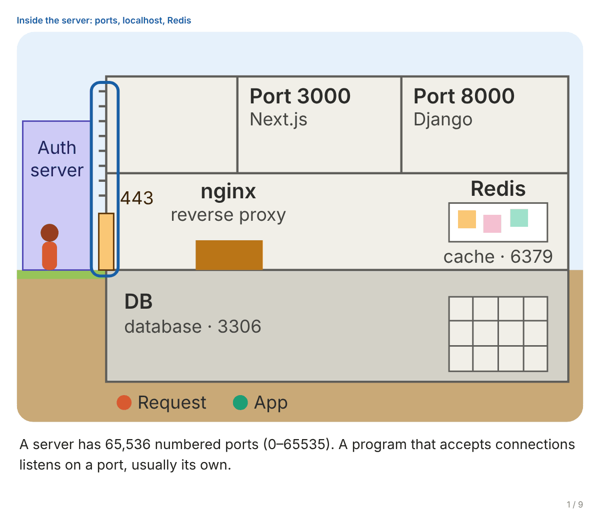

# [Weekly 5-Min Tech Talk] Inside the Server: Ports, localhost, and Redis

<table>
  <tbody><tr><td><b>Presenter</b></td><td>Olivia Lee</td></tr></tbody>
  <tbody><tr><td><b>Date</b></td><td>2026-11-25</td></tr></tbody>
  <tbody><tr><td><b>Keywords</b></td><td>Port, 443, localhost, 0.0.0.0, Reverse Proxy, Redis, Cache, Socket</td></tr></tbody>
  <tbody><tr><td><b>Series</b></td><td>Web Deployment, Deep Dives — 1 of 3 (follows Parts 1–2)</td></tr></tbody>
</table>

---

## TL;DR
What happens inside the server after a request comes in on 443 and passes nginx?
**A port is a door number, 443 is a standard, and 3000 is just a habit.** Who can reach a port depends on **where the program listens (localhost vs. 0.0.0.0) and the firewall**. Redis is a fast in-memory cache that sits in front of the database.

## Why This Topic
- In Part 1, I wrote `proxy_pass http://127.0.0.1:3000` in nginx. Why `127.0.0.1`, why `3000`, and why `443` on the outside?
- Django, Next.js, Redis, and a database run on the same server. How do they find each other, and how much of that is visible from outside?

## Core Concepts
- **Port:** A number (0–65535) that identifies a program on one machine. Normally, only one program listens on a given address and port.
- **Standard ports vs. conventions:** Ports 0–1023 are well-known (22 SSH, 80 HTTP, 443 HTTPS) and need root to open on Linux by default. Numbers like 3000 and 8000 are just defaults that tools have used for years.
- **localhost (127.0.0.1) vs. 0.0.0.0:** Where a program listens. `127.0.0.1` is reachable only from the same machine; `0.0.0.0` is reachable from the network too (unless a firewall blocks it).
- **Cache and Redis:** A cache keeps a copy of frequently used results close by and returns it right away. Redis keeps values in memory, so it's much faster than a database. Used as a cache, it sits in front of the database, which stays the source of truth.

## Deep Dive

### [Flow] One request's path inside the server



```text
Browser ─443─▶ nginx ──▶ 127.0.0.1:3000 (Next.js) ──▶ 127.0.0.1:6379 (Redis)
                                                   └─ on a miss ─▶ 127.0.0.1:3306 (DB)
```

1. When the browser sees an `https://` URL, it goes to **443** without being told.
2. **nginx** accepts the request on 443, presents the certificate, and forwards it to the right app based on the domain (reverse proxy).
3. The app (Next.js) receives it on an **address inside the same server** (`127.0.0.1:3000`).
4. The app checks **Redis** first. On a miss, it reads the **database** and saves the result to Redis.

### [Comparison] Ports you'll see often

| Port | Used by | Type |
| :--- | :--- | :--- |
| 22 | SSH | Well-known |
| 80 / 443 | HTTP / HTTPS | Well-known |
| 3000 | Next.js, Express, etc. | Convention |
| 5173 | Vite | Convention |
| 8000 | Django | Convention |
| 8080 | Alternative web port | Convention |
| 3306 / 5432 | MySQL / PostgreSQL | Registered default |
| 6379 | Redis | Registered default |

### [Comparison] Where a program listens

| Listen address | Who can reach it | Use it for |
| :--- | :--- | :--- |
| `127.0.0.1` (localhost) | Only programs on the same server | Databases, Redis, apps behind nginx |
| `0.0.0.0` | Everyone on the network (unless a firewall blocks it) | Programs that take outside traffic directly, like nginx |
| A private IP (e.g., `10.0.0.5`) | Servers on the same private network | When the app and the database run on separate servers |

## In Practice

**See which ports are open, and where**
```bash
sudo ss -tlnp
```
- If `Local Address` shows `127.0.0.1:6379`, it's internal only. `0.0.0.0:3000` or `*:3000` means it's open to the network.

**Keep Next.js internal**
```bash
next start -H 127.0.0.1 -p 3000
```
- `next start` listens on `0.0.0.0:3000` by default. Behind nginx, bind it to `127.0.0.1` or block 3000 with a firewall.
- Change the port with `-p` or the `PORT` environment variable. Setting `PORT` in `.env` doesn't work.

**Keep Redis internal** (`redis.conf`)
```text
bind 127.0.0.1          # listen on localhost only
protected-mode yes      # refuse outside clients when no password is set
```

**Basic caching pattern (cache-aside)**
```js
// node-redis client
const cached = await redis.get(key);
if (cached) return JSON.parse(cached);           // hit: return right away

const data = await db.query(/* ... */);          // miss: read the database
await redis.set(key, JSON.stringify(data), { EX: 60 });  // keep it for 60 seconds
return data;
```

## Key Takeaways
- **Who can reach a port = listen address + firewall.** nginx forwarding to `127.0.0.1` doesn't hide the app by itself. Check with `ss -tlnp`.
- **Keep databases and Redis on localhost.** Redis exposed to the internet is a common attack target.
- **One reason nginx holds 443 and apps use high ports:** Ports below 1024 need root on Linux by default, so this split keeps apps from running as root.
- **3000 isn't special.** If it clashes with another app, just pick another number.
- **Always set an expiry on cached data.** If the database changes but the cache doesn't, users see stale data. When Redis is a cache, keep the database as the source of truth: Redis holds data in memory and can evict it.

## Discussion
- Which ports on our servers listen on `0.0.0.0`? Is that intentional?
- What do we cache in Redis today, and for how long?
- For apps on the same server, would Unix sockets be better than ports?

## Glossary
- **Reverse proxy:** A server that takes outside requests, forwards them to an internal app, and returns the response. Example: nginx.
- **Bind:** When a program opens a specific address and port to listen on.
- **Socket:** One end of a connection, usually an `IP:port` pair. On the same machine, Unix socket files can be used instead.
- **WebSocket:** A connection that stays open so both sides can keep sending messages. Used for chat and live notifications.
- **Cache hit / miss:** The answer is / isn't in the cache.

## References
- [IANA — Service Name and Transport Protocol Port Number Registry](https://www.iana.org/assignments/service-names-port-numbers/service-names-port-numbers.xhtml)
- [Next.js — CLI (`next start` options)](https://nextjs.org/docs/app/api-reference/cli/next)
- [Redis — Security](https://redis.io/docs/latest/operate/oss_and_stack/management/security/)
- [ss(8) — Linux manual page](https://man7.org/linux/man-pages/man8/ss.8.html)

---
🔗 Related: [Part 1 — How My Code Reaches an https:// URL](./20261104_web_deployment_part1_from_code_to_url.md) · [Part 2 — Safer Requests, Automated Deploys](./20261112_web_deployment_part2_cloudflare_tunnel_and_cicd.md)
